# Deflake

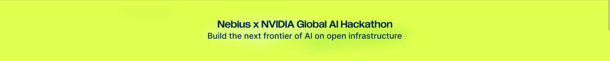

**Nebius x Nvidia Global AI Hackathon**


Hackathon link: [https://nebiusglobalaihackathon.devpost.com](https://nebiusglobalaihackathon.devpost.com/)


Track: **Coding and Agentic Engineering Track**


License: [Apache-2.0](LICENSE)

---

Deflake finds flaky tests in a Python project, explains why each one flakes, writes a small fix that has to change the cause, proves the fix with repeated runs, and routes it either to an automatic pull request or to a person.

A test that fails on every run is labelled broken and left as it is. A fix is called verified only after it survives the reruns and leaves the rest of the suite green.

## What Deflake uses

A scan has to sort a failure, explain it, write a fix, and decide whether a person must look. These are the pieces that do that work.

- **Nebius Token Factory**
  Runs every model step. Classification, the patch, and the diagnosis are different jobs, and each one has to come back as an answer the pipeline can check. One account reaches every size of model the scan needs, so a cheap triage step and a careful root-cause step share the same path.


- **NVIDIA Nemotron**

  The model family those steps call. A fast model sorts each failure and writes the search query, because there are many of them and each answer is short. A balanced model writes the patch and the note for the expert, because the diff has to be small and valid. A reasoning model diagnoses the cause three times, and the samples have to agree before Deflake treats the cause as settled.


- **Tavily**

  Looks outside the repository after a test is classified. A flake often matches an upstream bug report or a changelog, and that reference belongs next to the diagnosis. When the search finds nothing, or cannot be reached, the diagnosis still continues and the references tab says so.


- **Toloka**

  Checks whether a written cause actually matches its patch. Reviewers look at the explanation and the change together. Their agreement is what sets the confidence bar for an automatic pull request. Until enough pairs have been reviewed, Deflake keeps the default bar and the calibration screen says so.


- **Tendem**

  Takes a case when there is no safe patch, or when repeated runs do not prove the fix. The expert receives the runs, the diagnosis, and the patch attempts. When that handoff cannot be completed, Deflake keeps the case and the screen names who holds it.


- **LangSmith**

  Records each model call so a scan can be followed afterward. A call is tagged with the scan, the flake, the step, the model tier, and the prompt version.

## Let's understand by scenario

It is 6:40 PM on a Thursday. Meera, a platform engineer, is trying to ship a release. The pipeline is red. `test_checkout_applies_discount` passed on the same commit an hour ago. She clicks re-run. It goes green. She ships.

The next morning, three teams have wrapped their own unreliable tests in automatic retries. Over the following months, about one pipeline run in six fails for reasons unrelated to the change. Engineers stop reading failures and just press re-run. Then a real bug in payment rounding slips into production, because the test that caught it is "always flaky".

Meera tries an AI coding agent. It "fixes" one flaky test by adding a two-second sleep. The suite goes green. The race is still there, and every run is two seconds slower. She has no way to tell which of the agent's fixes are real and which only hide the problem.

Deflake is the tool she needed. It reruns the suite until flaky tests reveal themselves, works out why each one flakes, writes a minimal fix, and proves that fix with repeated runs. When it cannot prove a fix, it says so and hands the case to a person, with the evidence.

## The problem

A flaky test passes and fails on the same code. The failure does not show up on demand, and the cause is often somewhere other than the line that failed: a test that ran earlier and left state behind, a race, the clock, or unseeded randomness.

Retries and quarantine hide the failure. A dashboard can name which tests flake, and stop there. An AI coding agent will write a plausible fix, often a sleep, a retry, or a weaker assertion, and offer no proof that the cause is gone.

A green test is not proof. A patch can make a test pass while the bug stays.

## Solution

Deflake runs one loop.

1. **Detect.** Rerun the suite many times in random order. A test that fails only sometimes is flaky. A test that fails every time is broken, and is left alone.
2. **Diagnose.** Name the cause. When the flake depends on order, name the test that polluted the one that failed.
3. **Fix.** Write a small patch. A sleep, a retry, a skip, or a weakened assertion is rejected, and the rejection stays visible.
4. **Prove.** Rerun the fixed test many times, then the rest of the suite. Zero failures is the bar.
5. **Route.** A strong proof can open a pull request. A weak one, or a case with no safe patch, goes to a person with the runs, the diagnosis, and the patch attempts.

## Project Screenshots

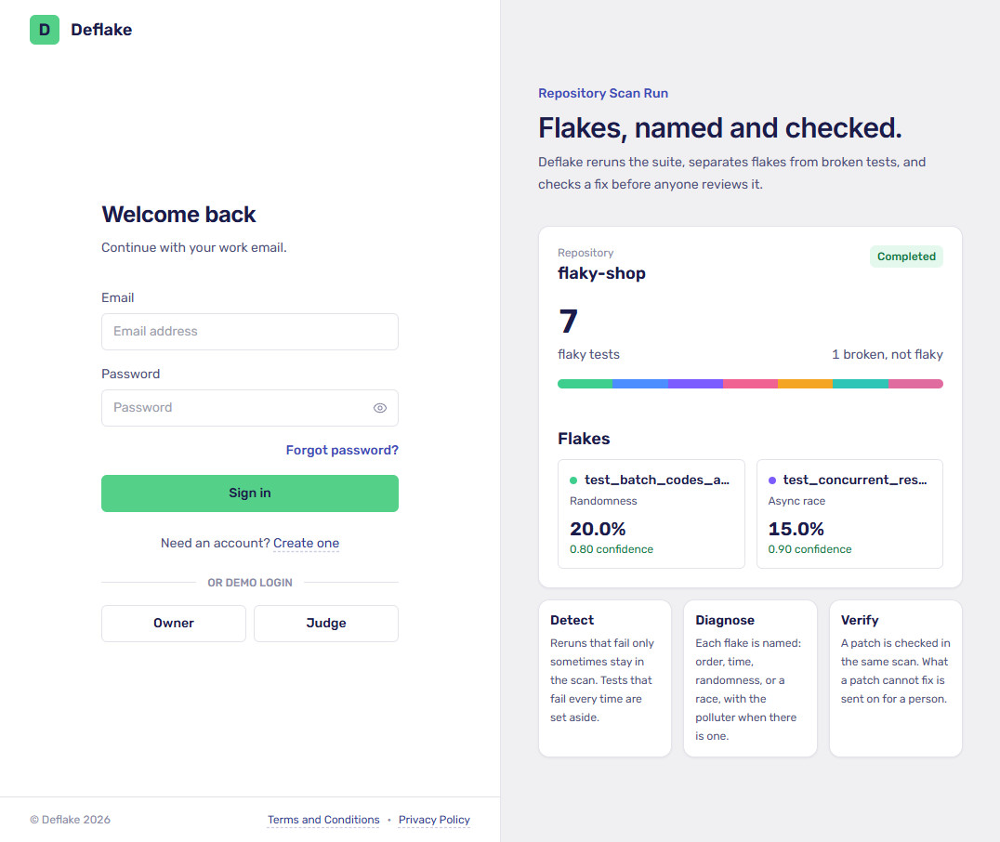

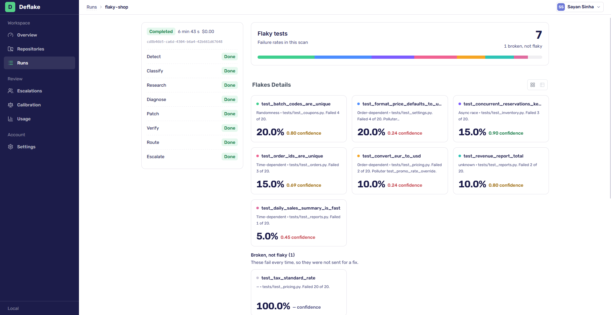&nbsp;&nbsp;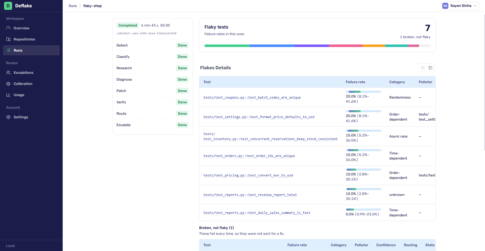

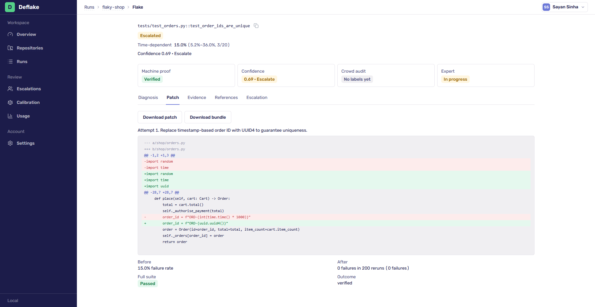&nbsp;&nbsp;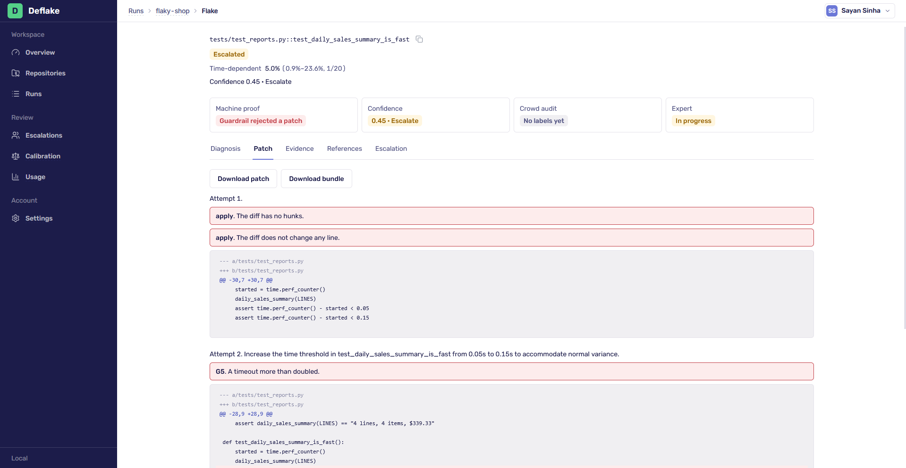

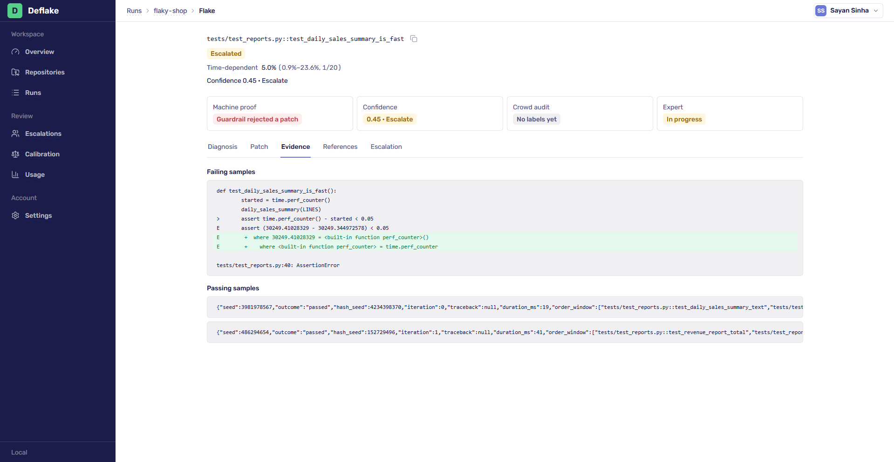&nbsp;&nbsp;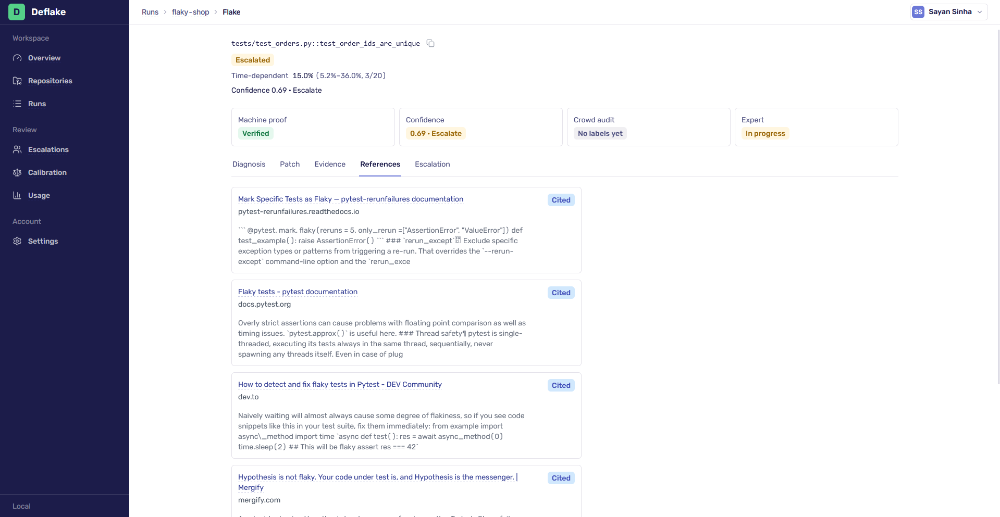

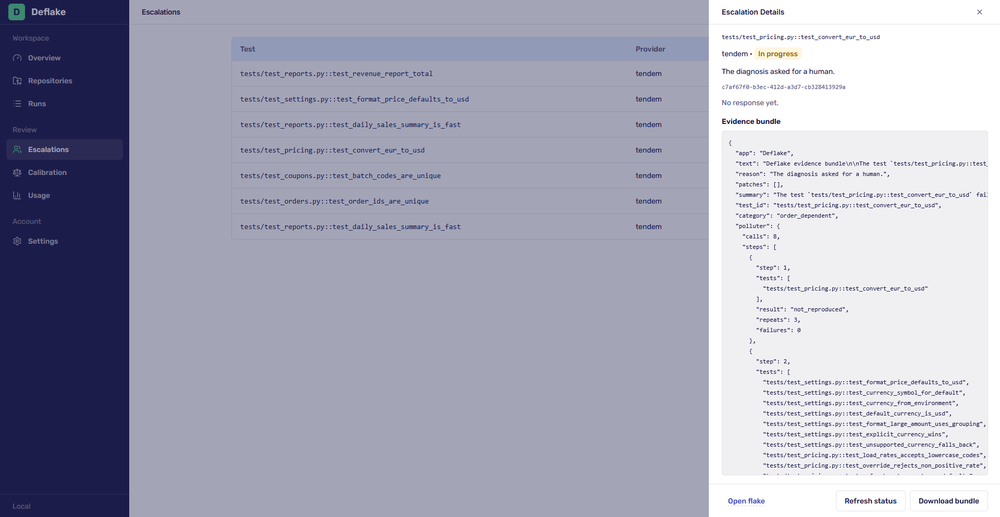&nbsp;&nbsp;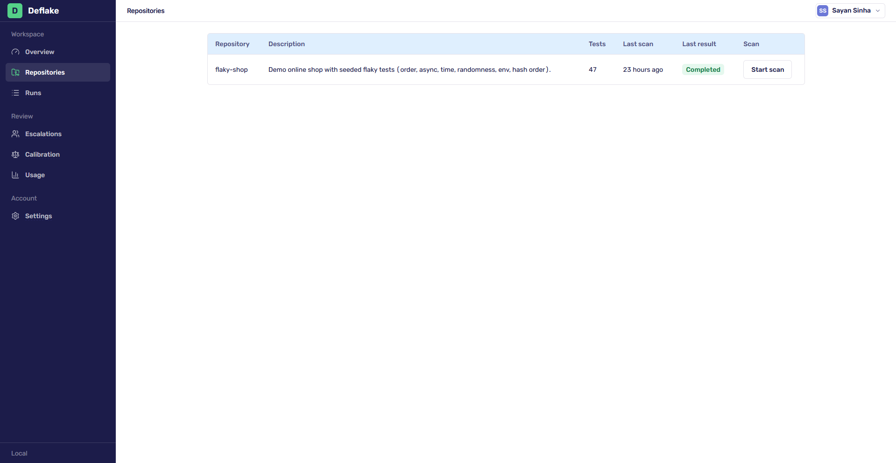

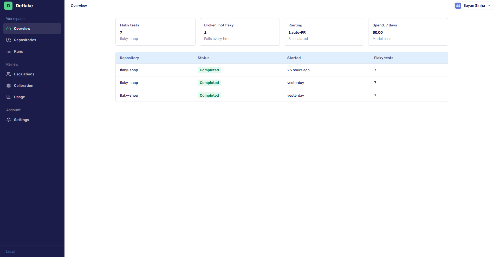

## Setup and run

Clone the repo

```bash
git clone git@github.com:sayansinha5/Deflake.git
```

From the repository root, copy the environment files:

**Step 1:** Copy the `.env.example` files in both the repos and rename them to `.env`.

**Step 2:** Update the values, example - API keys, client ids and client secrets.

**Step 3:** Open 2 terminals, open the `frontend` folder in one and `backend` in other.


### Running the frontend

In the frontend terminal, run the below one by one:

```bash
npm install
```

```bash
npm run dev
```


Open http://localhost:5173 in browser and leave that terminal open.

### Running the backend

Start the API, the runner, and MySQL:

```bash
docker compose up --build
```

It will take sometime for the first time. Leave it open.

---

Docker Compose starts a container named `Deflake` with three services:

- **api**

The backend api http://localhost:8000 to which the frontend communicates.


- **runner**

Runs the project's pytest suite. A scan copies one repository into a throwaway workspace, applies a patch only after it checks, runs the tests, and deletes that workspace.


- **mysql**

A persistent DB, that stores accounts, scans, flakes, patches, and the scan checkpoints.


Now, open the shell of the api service in Docker.


### Migration - Run this command for migration

```bash
sh scripts/migrate.sh
```


### Seed - Run this command for seed

Note: The seed loads the Owner, the demo account, and a finished scan of the sample shop. A new scan is started from the app and takes several minutes.

```bash
sh scripts/seed.sh
```


### Sign in with the demo member:

| Email | Password |
| --- | --- |
| `judge@deflake.local` | `Judge2026` |
| `owner@deflake.local` | `Owner2026` |

---

**Stop frontend:**

Go to frontend terminal, just press `Ctrl + C`


**Stop backend:**

Go to backend terminal, just press `Ctrl + C`. Or if running on `-d` then run command `docker compose down`


The database volume is kept.
---

## Nebius Token Factory + NVIDIA Nemotron

The reasoning engine. Three model sizes matched to task difficulty: Nano for cheap, fast triage; Super for writing code; Ultra for root-cause reasoning. This keeps cost and latency down without losing quality where it matters.

### Models used

Each step uses the Nemotron size that fits the job. Diagnosis is asked three times, and the cause has to agree across those samples.

| Tier | Model | Used for | Why |
| --- | --- | --- | --- |
| Fast | `nvidia/NVIDIA-Nemotron-3-Nano-30B-A3B` | Classification and the search query | Short structured answers, many of them |
| Balanced | `nvidia/nemotron-3-super-120b-a12b` | The patch and the expert summary | The diff has to be valid and small |
| Reasoning | `nvidia/Nemotron-3-Ultra-550b-a55b` | Diagnosis, three samples | The cause has to agree across samples |

### Where Nebius Token Factory helped

Every model step in a scan goes to Nebius Token Factory. One account reaches all three Nemotron sizes, so classification, the patch, and the diagnosis each use the model that fits the job. The same kind of structured answer came back on every tier, so the pipeline could stay one client and still receive a category, a diff, or a root cause it could check.

## Tavily

After a test is classified, Tavily looks for an upstream bug report or changelog that matches the failure. Those references sit with the diagnosis. When search finds nothing, or is unavailable, diagnosis continues and the references tab says so.

## Toloka

Toloka is the crowd check on whether a diagnosis matches its patch. Reviewers look at the explanation and the change together. Their agreement calibrates the confidence score and sets the bar for an automatic pull request. Until enough people have reviewed the pairs, Deflake keeps the default bar and the calibration screen says so.

## Tendem

Tendem takes a case when there is no safe patch, or when the repeated runs do not prove the fix. The expert receives the evidence: the runs, the diagnosis, and the patch attempts. When that handoff cannot be completed, Deflake keeps the case itself and the screen names who holds it.

## LangSmith

LangSmith records each model call so a scan can be followed afterward. A call is tagged with the scan, the flake, the step, the model tier, and the prompt version.
